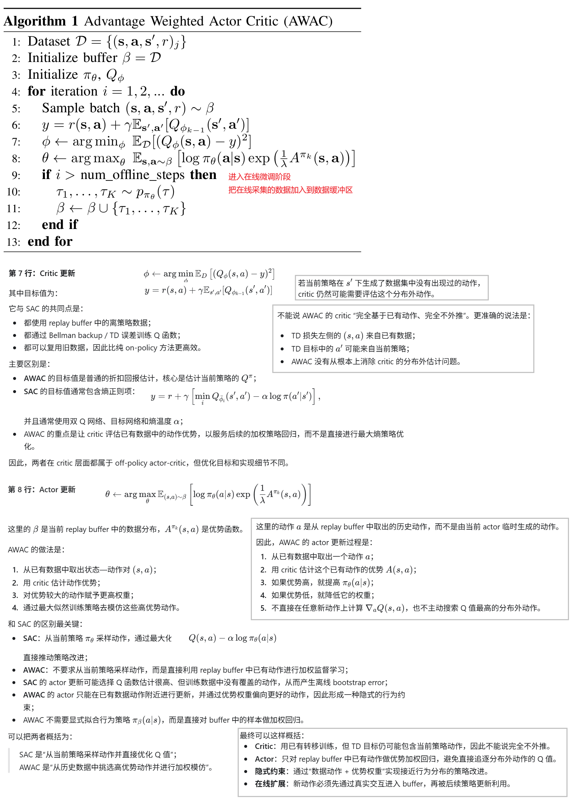
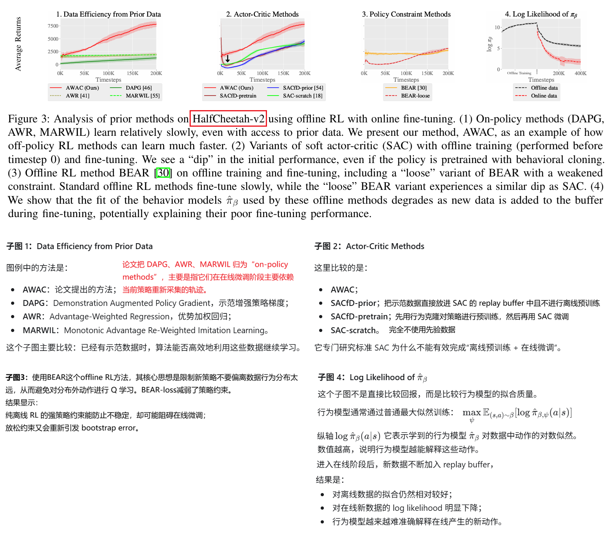
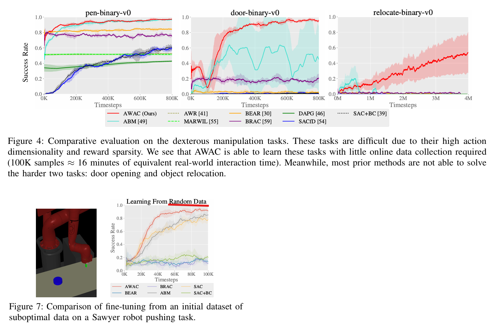

**AWAC: Accelerating Online Reinforcement Learning with Offline Datasets**

from UC Berkeley

这篇论文投过ICRL‘2021，但是被拒稿。作者之一Sergey Levine非常牛逼，IQL/SAC/RT-1,2/OpenVLA/Octo都是他的论文。

**Decision:** Reject

**Comment:**This paper proposed a new method improving online reinforcement learning using offline datasets. Three reviewers suggested (borderline) acceptance and two did rejection. The main concerns of reviewers are (a) limited/incremental novelty (from all reviewers) and (b) limited experiments (from three reviewers). AC also agrees that the authors' response for novelty beyond the prior works, e.g., AWR (and CRR), is not convincing enough (although their goals/settings are different). AC also thinks that more discussion, analysis and results when offline datasets are poor (e.g., far from experts) are necessary to meet the high standard of ICLR (the authors provided some, but AC thinks it is not convincing enough). Hence, AC recommend rejection.

### Introduction

**1、背景：为什么要结合离线数据与在线强化学习？**

传统强化学习通常从零开始在线探索。对于机器人而言，真实环境交互成本高、动作空间维度大、奖励又常常稀疏，因此“边探索边学习”往往需要大量时间。论文希望利用已有数据进行离线预训练，再通过少量在线交互继续改进策略。已有数据可以来自专家示范、次优策略、随机探索或过去的强化学习运行。

**2、问题：现有方法为什么难以完成离线预训练后的在线微调？**

论文系统分析了三个主要障碍：

1. **数据效率不足**：行为克隆或基于蒙特卡洛回报的方法虽然能使用示范数据，但在线微调时样本效率低。
2. **离线训练中的自举误差**：标准离策略 actor-critic 会对数据分布之外的动作进行 Q 值估计和 bootstrap，误差会逐步累积，导致策略性能下降。
3. **在线微调过于保守**：许多离线 RL 方法通过显式学习行为策略、限制策略分布偏移来避免分布外动作。它们离线训练效果较好，却难以随着新采集的在线数据不断改进。

因此，真正困难的目标是：既要充分利用离线数据，又要避免离线训练的分布偏移问题，同时还要允许策略在在线阶段继续大胆改进。

**3、解决方法：AWAC（Advantage Weighted Actor Critic）**

AWAC 将两种机制结合起来：

- **Critic 使用离策略时序差分学习**：通过 Bellman backup 学习 Q 函数，能够高效复用离线数据和在线经验。
- **Actor 使用优势加权的最大似然更新**：对数据中的动作按照优势函数加权，优势越高的动作，训练权重越大。
- **隐式约束策略更新**：AWAC 直接从 replay buffer 中采样已有动作，不显式拟合行为策略模型，从而避免行为模型随在线数据变化而失配，也比显式约束方法更不保守。

所以，AWAC 的关键思想是：用 off-policy critic 保证数据效率，用 advantage-weighted supervised actor update 避免分布外动作和过度保守更新。

**4、效果：实验验证了什么？**

论文在模拟环境和真实机器人上进行了验证：

- 在 MuJoCo 灵巧操作任务中，AWAC 在 pen、door、relocate 等任务上明显优于 AWR、DAPG、SAC、BEAR、ABM 等基线。
- 例如 pen 任务约用 **120K 个在线时间步**即可学会，相当于约 **20 分钟的等效真实交互时间**；其他方法在 door 和 relocate 等任务上往往无法在相同时间范围内成功。
- AWAC 能够利用不同质量的离线数据，包括专家示范、次优数据和随机探索数据，不需要针对数据来源修改算法。
- 在真实机器人实验中，AWAC 应用于：
  - 三指夹爪旋转阀门；
  - Sawyer 机械臂打开抽屉；
  - 四指机械手重新摆放物体。
- 结果显示，AWAC 离线预训练后已经具有合理初始性能，并且能通过在线交互持续提升；许多基线要么无法有效利用离线数据，要么在线微调进展很慢。
- 论文还通过消融实验证明，off-policy critic、bootstrap 学习以及 AWAC 的隐式约束形式都是性能的重要组成部分。

论文的局限是：约束强度等超参数仍需选择；方法缺乏完整理论解释；跨机器人、跨任务共享数据的能力还未充分验证。

### Method

### Experiments

摘录部分有代表性的图表：

### 困惑

#### 困惑1

**Q**：以AWAC为例，我对于先offline rl或者先IL，然后 online rl继续微调的这种方式，两阶段之间为什么会有gap觉得很费解。毕竟像robomimic的实现或者机器人邻域的实践经验显示：即使只做offline RL或者IL通常也是足够的，说明前半段的offline RL/IL通常能训练一个不错的模型了，这个模型与环境交互通常是有还不错的表现，这时候再用常见的SAC等online RL算法再简单训练一下，应该会更有长进，如果online RL阶段不进反退，那通常是online RL的超参数不合适等低级错误。offline-to-online的GAP看起来不是一个需要研究的专门的挑战。大模型和CV模型，他们的微调通常是针对切换了任务场景的适配。我上面说的这种连任务场景都没有切换，为什么会有gap呢

**A**：Offline-to-online 的困难不是“只要从离线切到在线，模型就会变差”：

- **离线切在线并不必然存在 gap**：如果 actor、critic 都足够准确，且训练目标保持一致，继续在线训练理应能够改进。
- **策略表现好，不代表 critic 能指导改进**：IL 通常没有 critic；离线 RL 的 critic 也可能高估数据未充分覆盖的动作，导致 SAC 把好策略改坏。
- **任务不变，训练条件仍可能改变**：优化目标、探索方式和数据分布的变化，都可能引起性能下降。
- **真正的挑战是有限交互下保住能力并继续提升**：但新方法应当与认真调优的 SAC 基线比较，不能把所有微调失败都归因于所谓的 gap。
- 机器人领域的 offline RL／IL 一方面受限于离线数据采集成本高，可能存在数据覆盖不足、学习效果不佳的问题；另一方面，细微的环境差异和策略更新都可能引起分布偏移，影响实际性能。**Offline-to-online RL 旨在利用有限的在线交互，在保留已有能力的基础上进一步提升策略性能。**

### 代码

官方代码在[这里](https://github.com/rail-berkeley/rlkit/tree/master/examples/awac)，特别值得注意的是它基于的[rlkit](https://github.com/rail-berkeley/rlkit)库，虽然代码比较老依赖的库比较旧，但借助AI的帮助还是能够比较容易的跑起来，依赖的库也不多。

| 维度         | rlkit                                     | SB3                          |
| ------------ | ----------------------------------------- | ---------------------------- |
| 主要用途     | 研究新算法、复现论文、组合实验组件        | 用标准算法训练任务           |
| 扩展方式     | 经常直接修改 trainer、组装内部组件        | 更多围绕统一 API 和扩展接口  |
| 强项         | 离策略 RL、离线到在线学习、机器人研究积累 | 文档、标准接口、常规使用体验 |
| 当前使用成本 | 需要理解历史依赖和实验配置                | 通常更适合作为通用起点       |

另外，该论文的团队的另外一个机器人相关的软件库，[serl](https://github.com/rail-berkeley/hil-serl)看起来不错，不过是基于jax的。