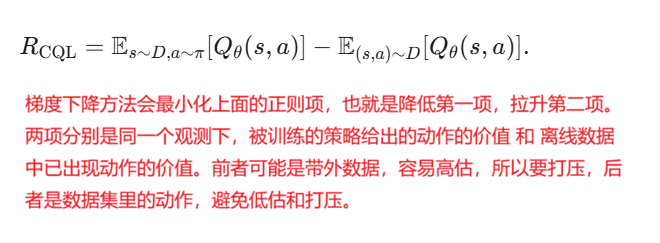
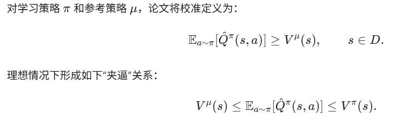
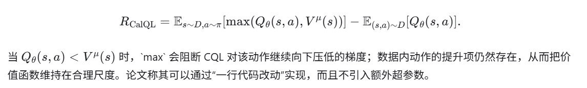
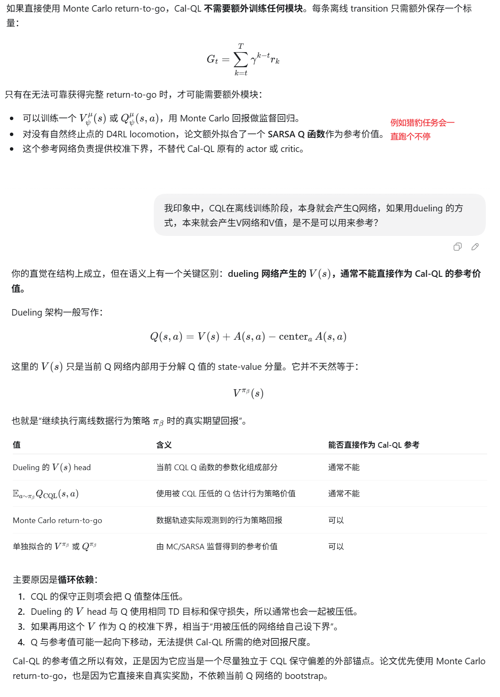
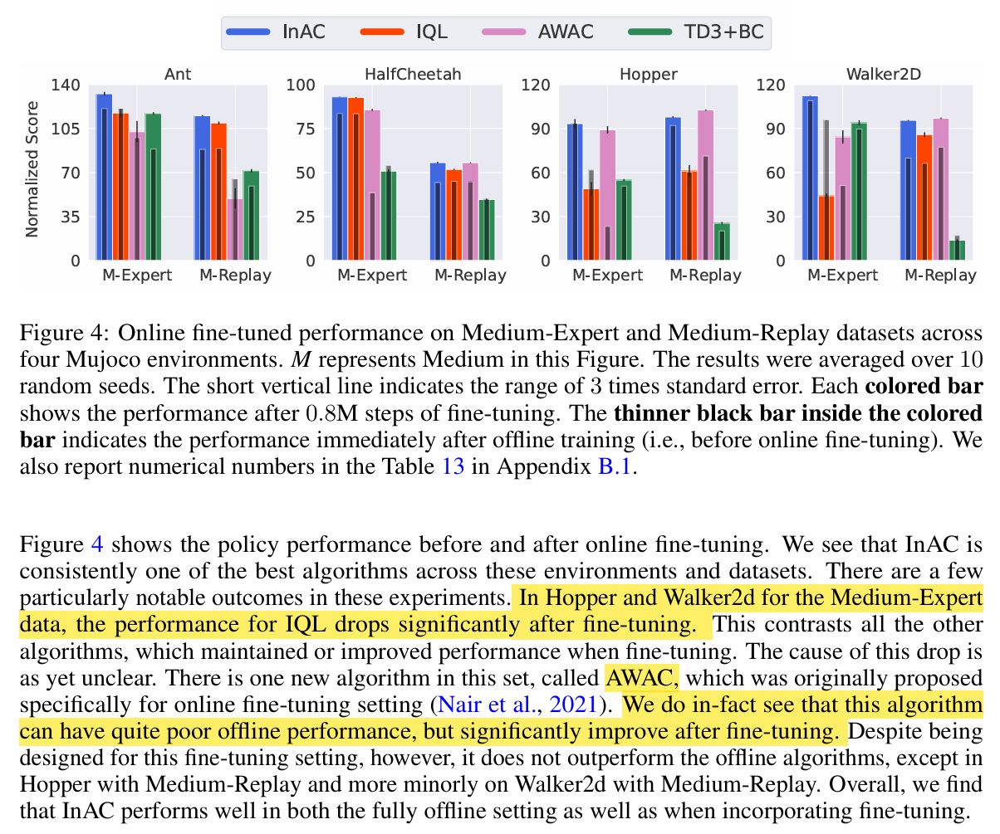

**Cal-QL: Calibrated Offline RL Pre-Training for Efficient Online Fine-Tuning**

NeurIPS'2023, from UC伯克利大学和斯坦福大学

一句话描述：Cal-QL 基于 CQL，通过以离线数据行为策略的参考价值校准其可能被过度低估的 Q 值，避免在线微调初期的性能回退，从而实现更稳定、更高效的在线微调。

#### 1. 背景：离线预训练加在线微调

强化学习中的理想范式是：

> 先利用已有静态数据进行离线 RL 预训练，得到较好的策略和价值函数；再用少量在线交互进行微调。

这一范式尤其适合机器人等交互昂贵或危险的场景：智能体不必从随机策略开始探索，理论上可以显著减少在线样本。

但已有研究观察到一个反直觉现象：

- 离线表现越好的方法，在线微调有时反而越差。
- IQL、AWAC、TD3+BC 等方法通常在线提升较慢。
- CQL 虽然最终性能较好，却会在微调刚开始时丢失离线阶段学到的策略，即“初始反学习”。
- 从头训练的在线方法改善较快，但前期必须执行大量低质量策略，不适合真实机器人控制场景。

因此，真正需要的不是单纯“离线性能更好的初始化”，而是一个既有较高初始性能、又适合继续在线学习的初始化。

#### 2. 问题：CQL 为什么会反学习

CQL 通过保守正则项压低分布外动作的 Q 值，以避免离线 RL 中常见的分布外过估计：

这种悲观性在离线阶段是必要的，但论文发现，CQL 可能把 Q 值压得远低于任何真实策略的回报尺度。

论文在稀疏奖励视觉抓取任务中的诊断过程如下：

1. 离线训练结束时，CQL 策略已有约 0.5 的归一化成功率，但平均 Q 值一度低至约 `-40`。
2. 在线微调开始后，探索产生的新动作实际上可能比离线策略更差。
3. 但这些动作的真实回报仍可能高于被严重低估的离线 Q 值，于是在当前价值函数看来反而“更优”。
4. 策略优化器因此离开原本较好的离线策略，性能快速下降。
5. 随着在线数据积累，Q 值重新调整到真实尺度，策略才恢复原有性能并继续提升。

因此，CQL 的问题不是“太保守”本身，而是：

> Q 值虽然保持了相对排序上的悲观性，却失去了与真实回报之间的绝对尺度。

离线阶段学得越保守，并不代表在线微调越稳定。微调前期的大量样本实际上被用于重新校正 Q 值，而不是改进策略。

#### 3. 解决方法：在保守性之外加入校准

Cal-QL 希望学习同时满足两项性质的 Q 函数：

- **保守性**：估计值不高估当前策略的真实价值。
- **校准性**：估计值不能低于某个可实现的参考策略价值。

其中右侧来自保守性，左侧来自校准性。参考策略通常直接选择生成离线数据的行为策略，因为它的价值容易从数据中的 return-to-go 估计。

**Cal-QL 对 CQL 的核心修改只有一处：**

在线阶段仍从离线数据与新在线数据的混合回放池中训练。参考价值可以通过以下方式获得：

- 终止式任务：直接使用轨迹的 Monte Carlo return-to-go。
- 无明确终止的持续任务：拟合行为策略的 Q/V 网络。
- 实验表明，用神经网络近似参考价值与直接使用 Monte Carlo 回报的效果接近。

#### Cal-QL 与 CQL 对比

| 对比维度     | CQL                                | Cal-QL 新增或修改                                        |
| ------------ | ---------------------------------- | -------------------------------------------------------- |
| 主要目标     | 防止离线 RL 对分布外动作过估计     | 同时保持悲观性与正确的价值尺度                           |
| OOD 动作处理 | 持续压低策略采样动作的 Q 值        | 只压到参考策略价值 \(V) 附近，不再无界下压               |
| 保守正则项   | 使用 Q                             | 替换为 max(Q,V)                                          |
| 价值下界     | 没有显式下界，可能低于任何有效策略 | 以参考策略价值作为校准下界                               |
| 参考策略     | 不需要                             | 通常采用 产生离线数据的行为策略                          |
| 离线性能     | 通常较好                           | 与 CQL、IQL 的离线初始化大致相当                         |
| 在线微调初期 | 容易出现 Q 值跳变和策略性能下跌    | 显著减轻性能下跌，可平稳进入在线阶段                     |
| 渐近性能     | 调整完 Q 值后可能较好              | 保留 CQL 的良好渐近性能，同时减少恢复成本                |
| 实现成本     | 原始 CQL 目标                      | 一行目标函数修改，无新增超参数                           |
| 高 UTD 配置  | 高更新比也可能过拟合               | UTD=20 时结合 Q 网络层归一化与 critic ensemble           |
| 最适用数据   | 高覆盖数据上表现稳定               | 对窄分布、专家型数据尤其有效；高覆盖数据上近似退化为 CQL |

#### 4. 实验效果

实验覆盖 11 个在线微调任务：4 个 AntMaze、3 个 FrankaKitchen、3 个 Adroit 灵巧手任务，以及一个基于图像的机器人抓取放置任务。

| 指标                            | CQL     | IQL     | Cal-QL      |
| ------------------------------- | ------- | ------- | ----------- |
| 平均归一化分数：微调前 → 微调后 | 42 → 71 | 50 → 69 | **44 → 90** |
| 相对初始性能提升                | +71.0%  | +37.7%  | **+106.9%** |
| 取得最佳最终性能的任务数        | -       | -       | **9/11**    |
| 平均累积遗憾，越低越好          | 0.41    | 0.38    | **0.22**    |
| 取得最低遗憾的任务数            | -       | -       | **8/11**    |

主要实验结论：

- Cal-QL 的离线初始性能与 CQL、IQL 相近，但在线提升幅度明显更大。
- 平均遗憾为 `0.22`，比次优的 IQL `0.38` 低约 **42%**。
- 在 relocate 任务上，Cal-QL 从 `3` 提升到 `98`；只有 Cal-QL 和使用离线数据的 SAC 达到 90% 以上，但后者没有高质量离线初始化。
- 在窄分布数据上，CQL 的 Q 值严重低估并在微调时发生性能崩塌；Cal-QL 基本无反学习。
- 在高覆盖 AntMaze 数据上，两者的 Q 值本就接近，Cal-QL 的约束触发率接近 0，因此表现自然接近 CQL。
- UTD 从 1 提高到 20 后，单独提高更新频率会过拟合；加入层归一化和 critic ensemble 后，Cal-QL 通常优于 UTD=1，并比从头在线训练的 RLPD 具有更小遗憾。
- 附录的 15 个 D4RL locomotion 任务中，Cal-QL 最终平均分 `0.90`、遗憾 `0.17`，与 CQL 的 `0.96` 和 `0.12` 相当但并未全面超过，说明其优势主要集中在会发生尺度失校准的窄分布数据上。

#### 5. 论文边界与核心结论

论文的主要限制是只研究“离线预训练和在线微调属于同一任务”的情况；理论分析也采用理想化的有限时域、双线性模型，并简化了悲观性的处理。Cal-QL 还要求能够得到一个相对合理的参考价值估计。

整篇论文最重要的认识是：

> 离线 RL 初始化要适合在线微调，仅有悲观性不够。价值函数既不能高估未知动作，也不能低到失去真实回报尺度。Cal-QL 用行为策略价值给 CQL 增加一个下界，在几乎不增加实现复杂度的情况下，保留离线性能并显著减少在线微调初期的反学习。

#### 6 代码

[这里](https://github.com/nakamotoo/Cal-QL)， 基于jax架构的。由于CalQL相对CQL改动较小，用robomimic里的CQL直接修改可能是不错的选择。

#### 附录

论文引用的文献[57]中的Fig.4，佐证论文提到的Offline RL算法经过online finetune后性能反而变差的反直觉现象。具体就是IQL和TD3+BC都出现了，AWAC也不保证每次finetune都有效果。

