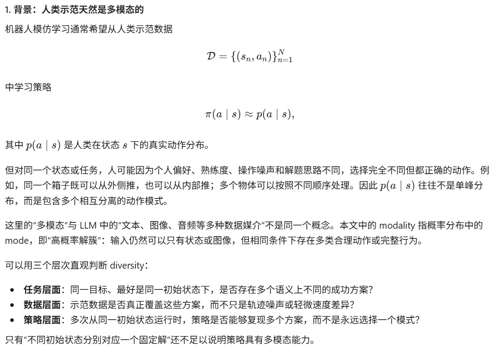
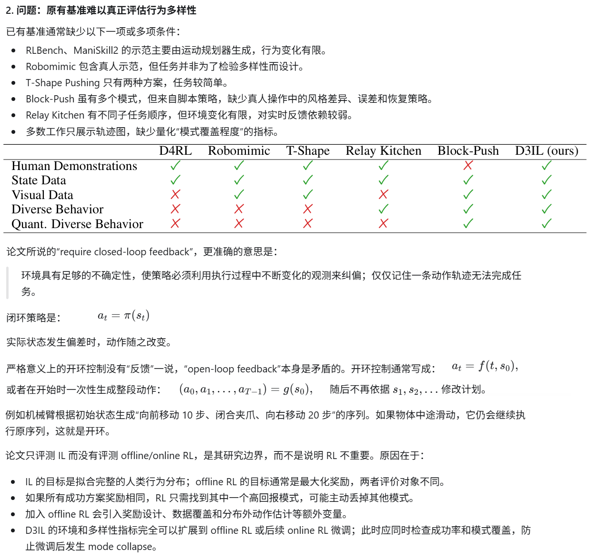
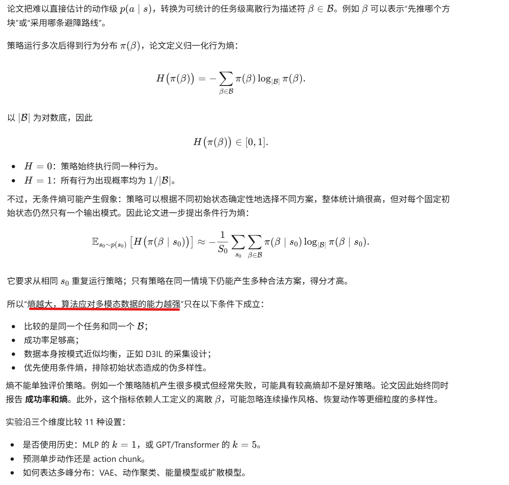
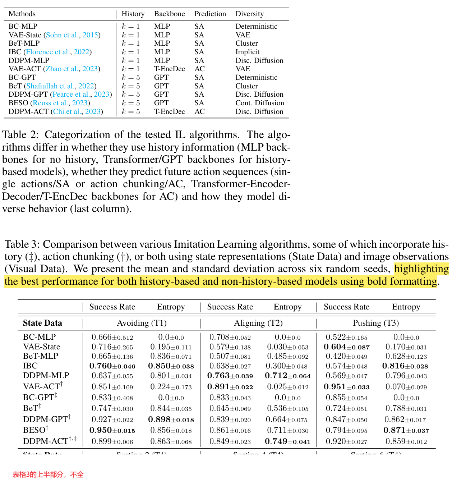
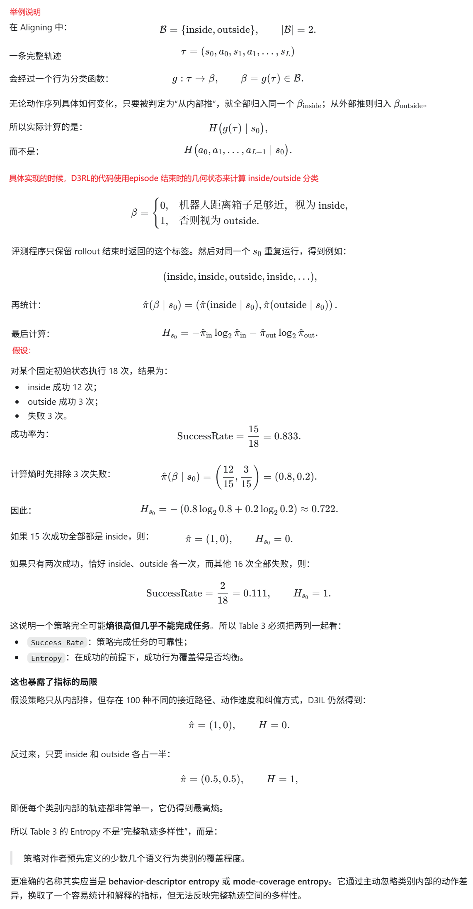
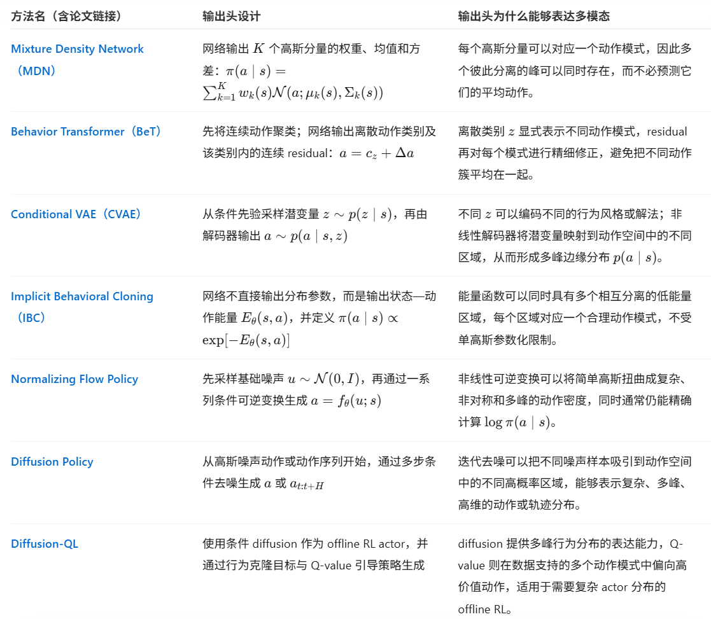

TOWARDS DIVERSE BEHAVIORS: A BENCHMARK FOR IMITATION LEARNING WITH HUMAN DEMONSTRATIONS

ICLR'2024, from 德国卡尔斯鲁厄理工学院（实力较强、活跃）

一句话描述：IL 离线数据的多模态性，是指面对同一任务乃至同一初始场景，示范者可以采用多种语义上不同但都能成功的解法，例如从箱子内侧或外侧推动、按不同顺序处理物体；D3IL 据此构建 benchmark 任务及配套的离线人类示范数据，以“成功率 + 固定初始状态下成功模式的条件熵”衡量 IL 策略能否在完成任务的同时复现这些多模态行为，并系统评测了当时具有代表性的前沿 IL 算法。

### Introduction

#### 1 背景



#### 2 问题



#### 3. 方法

D3IL 如何构造并量化多样行为。D3IL 的任务设计遵循四个高亮出的原则：

1. 一个任务包含多种明确且合法的成功方案。
2. 示范来自多个人类操作者，保留操作风格、质量和恢复行为的差异。
3. 轨迹长度可变，要求模型处理不同时间尺度。
4. 每次运行都改变初始条件，使任务必须依靠闭环感知完成。

主要任务如下：

| 任务 | 行为描述符  | 模式数  | 示范规模 |
|---|---|---:|---:|
| Avoiding | 绕过 6 个障碍物的路径选择 | 24 | 96 |
| Aligning | 从箱子内部或外部推动 | 2 | 1000 |
| Pushing | 两个方块及目标区的处理顺序 | 4 | 2000 |
| Sorting-2/4/6 | 红蓝方块的排序顺序 | 2/6/20 | 600/1054/1560 |
| Stacking | 三种颜色方块的堆叠顺序 | 6 | 1095 |



#### 4. 效果与实验结论

**扩散模型在“成功率—多样性”之间取得了最稳定的平衡。** 在状态输入下，DDPM-GPT、BESO 和 DDPM-ACT 在 Avoiding、Aligning、Pushing 上通常同时保持较高成功率和熵。例如 Pushing 中，VAE-ACT 成功率达到 \(0.951\)，但熵仅 \(0.070\)；DDPM-ACT 则达到 \(0.920\) 成功率和 \(0.859\) 熵，更完整地保留了多种行为模式。

**确定性 BC 会发生预期中的模式坍缩。** BC-MLP、BC-GPT 在多个任务上成功率尚可，但熵基本为 0。VAE 能生成不同动作，却也常出现低熵；IBC、BeT 和扩散模型更能覆盖多个模式。

**Transformer、历史输入和预测时域通常有效，但不是越长越好。** DDPM-GPT 在前三个任务上的平均成功率比 DDPM-MLP 高约 21%。不过，历史长度和预测时域继续增加时，成功率与熵反而下降；同时使用长历史和 action chunk 的 DDPM-ACT，在状态任务中也没有稳定超过 DDPM-GPT。

**状态和图像输入各有优势。** 状态特征适合要求精确位置控制的 Aligning：状态方法最高成功率约 \(0.861\)，图像方法最高仅约 \(0.359\)。但手工拼接状态会随物体数量线性膨胀，难以利用置换等不变性；Sorting-6 中状态方法几乎全部失败，而图像方法的最高成功率达到 \(0.748\)。图像表示因此更适合多物体场景，但较难恢复细粒度空间关系。

**复杂任务仍未解决。** Sorting-6 的状态策略基本失效；完整堆叠三个方块也很困难。图像版 DDPM-ACT 在 Stacking-1/2/3 上的成功率分别为 \(0.752/0.513/0.244\)，说明历史和动作块有帮助，但距离可靠执行仍很远。

**小数据条件下 Transformer 和扩散方法更稳健。** Aligning 只使用 10% 数据时，多数 MLP 方法接近失效，而 BESO 仍有 \(0.436\) 成功率，DDPM-GPT 和 DDPM-ACT 也保留约 \(0.34\) 的成功率。作者据此认为 Transformer 更具数据效率，扩散目标可能还有正则化作用。

**扩散步数主要提高多样性，而非成功率。** 增加 denoising steps 时，熵明显上升而任务成功率相对稳定。不过代价是推理更慢：附录中 GPT 扩散模型的单步推理约为 30–44 ms，而普通 BC/VAE 通常只有数毫秒。

关于实验设置中的两处批注，需要保留审慎判断：

- 论文使用 **500 个 epoch 训练状态模型、200 个 epoch 训练图像模型**。图像前向和反向传播每个 epoch 更昂贵，所以较少 epoch 可能是算力折中；但“每个 epoch 更贵”并不能证明“需要的更新次数更少”。论文没有给出收敛曲线或等算力对照，因此“已经确保收敛”证据不足，你认为图像模型可能需要更多训练是合理质疑。
- 图像模型每训练完总进度的 \(1/10\) 就在环境中评估，并选择任务表现最好的 checkpoint；状态模型却根据 90/10 划分后的最低 validation loss 选模型。作者以仿真评估成本高解释后者，但这种不统一会影响 state/image 的公平比较，因为 imitation loss 与闭环控制成功率往往相关性较弱。更严谨的方案是：两类输入都在独立的 validation 初始状态上做 rollout 选优，最终只在 test states 上评估一次。你偏好的“按任务表现选优”确实更符合机器人控制目标，但不能直接在测试环境上反复选 checkpoint，否则会产生测试集泄漏。**没有把测试数据用于梯度更新，确实不属于“训练数据泄露”**。但如果根据测试集上的成功率选择 checkpoint，仍然属于更广义的**测试集信息泄露或测试集过拟合**，因为 checkpoint 选择本身也是学习流程的一部分。


D3IL 最有价值的地方，是把“会不会做任务”和“会不会以多种方式做任务”拆成成功率与条件行为熵两个维度，并通过真人示范、多个合法方案、可变轨迹长度和闭环环境构造了比早期基准更有区分度的测试集。

它的边界也很明确：行为描述符依赖人工设计；最大熵只适用于刻意均衡的模式分布；实验仍以仿真为主；模型选择协议不完全一致；而且它只评测了 IL。因而最准确的结论不是“扩散模型已经解决多模态机器人学习”，而是：**在 D3IL 所定义的离散行为多样性上，带历史建模的扩散策略目前最能兼顾任务成功与模式覆盖，但在多物体、长时序和精细操作任务上仍有明显缺口。**



### 解惑

#### 1 表格3中的熵怎么计算的



#### 2 问题理解上的重大出入

```
论文并没有得出方案设计上的直观的理解和tips。按照我一开始对多模态问题的理解，神经网络的动作输出头如果是输出正态分布的参数（例如均值，或者均值和 log标准差），那这个方案就不能很好的应对多模态的任务。  论文反而得出的是transformer  / diffusion这样的前端的encoder带来的差异，匪夷所思
```

可以把多模态 IL 的方案设计归纳为两个相对独立的问题：

1. **策略的输出分布能否表示多个合理解法**

   首先应排除“伪多模态”：如果同一观测对应不同动作，只是因为策略缺少任务目标、历史信息或当前阶段，那么应先补充这些条件。若在信息充分、初始场景相同的情况下仍存在多个合理解法，才是真正的条件多模态。

   此时，确定性 MSE 输出头会趋向于预测多个模式的平均动作；即使网络同时输出均值和 `log_std`，单高斯也仍然只有一个峰，容易在不同模式之间生成无效动作。因此应根据模式复杂度采用：

   - 模式少且语义明确：离散模式分类 + 每个模式内部的 residual policy；
   - 模式较多但可聚类：mixture model、action cluster 或 mixture-of-experts；
   - 模式高维且难以预定义：VAE、EBM 或 diffusion。

   

   ```
   bison：好烦躁！原本以为机器人控制是典型的多维连续动作空间的RL问题，输出头设计为多维的N(mean, log_std)就可以了，结果上面一大串这么复杂的东西。一点都不优雅简约
   ```

2. **选定解法后，策略能否长期一致并闭环执行**

   多模态输出头解决的是“能够选择不同解法”，但不能保证策略选定一种解法后稳定完成。策略一旦选择了某种解法，例如从箱子内部推，后续动作就应该持续服务于这个解法，同时根据箱子的实际运动不断纠偏，而不是下一步突然改成从外部推。

   可以用三类机制解决：

   1. **显式保持模式变量**。显式模式保持可以采用分层策略：高层在 episode 或子任务开始时选择一个解法 \(z\)，低层将 \(z\) 当作附加 goal，持续进行闭环控制；高层和低层可以通过 IL、RL 或外部规划器获得，并不必然需要分层 RL。如果由外部明确指定 模式，那么训练时必须让模型知道每条示范对应哪个 模式。但**不需要把数据物理拆成多个数据集**，可以把所有模式混合训练，只需给每条轨迹附上模式标签。这种机制**适用范围最窄、数据工程最不易扩展**，它把困难转移给了人工设计和数据管理。
   2. **RNN、Transformer、SSM 等历史模型**。模型从历史轨迹推断“刚才已经选择了 inside，现在应该继续”。适用于当前单帧无法看出任务阶段、接触状态或此前选择的情况。但如果当前完整状态已经明确反映了所选方案，例如机器人已经位于箱子内部，那么普通 MLP 也可能足够，不一定需要 RNN。
   3. **Action chunking**。一次生成一段相互协调的动作，可以减少逐步独立采样造成的抖动和临时改主意。不过不能长时间开环执行整个 chunk，否则箱子打滑后无法及时纠偏。通常是预测 \(H\) 步，只执行前几步，然后获取新观测并重新规划。

   历史模型负责记住任务阶段和此前的行为选择，Action Chunking 负责让短期动作保持连贯；二者都是维持时序一致性的手段，但不是必需组合。策略仍应每一步或每个短 chunk 根据最新观测重新规划，以保持闭环纠偏能力。

   

因此，最清晰的设计思路是采用分层策略。其中高层变量 负责选择并保持一种行为模式，低层策略根据实时观测闭环执行和纠偏。

简言之：

> **多峰输出分布负责“会多种解法”，模式保持、历史建模和 action chunking 负责“选定一种解法后持续、稳定地完成”。Transformer 本身不能让确定性或单高斯输出头获得真正的多模态能力。**


### 代码

[代码](https://github.com/ALRhub/d3il)初步看是基于pytorch，也提供了[数据](https://alrhub.github.io/d3il-website/)