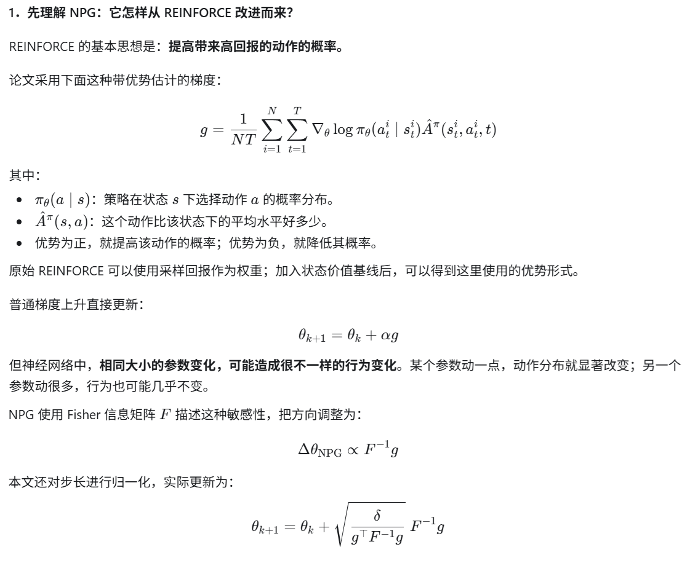
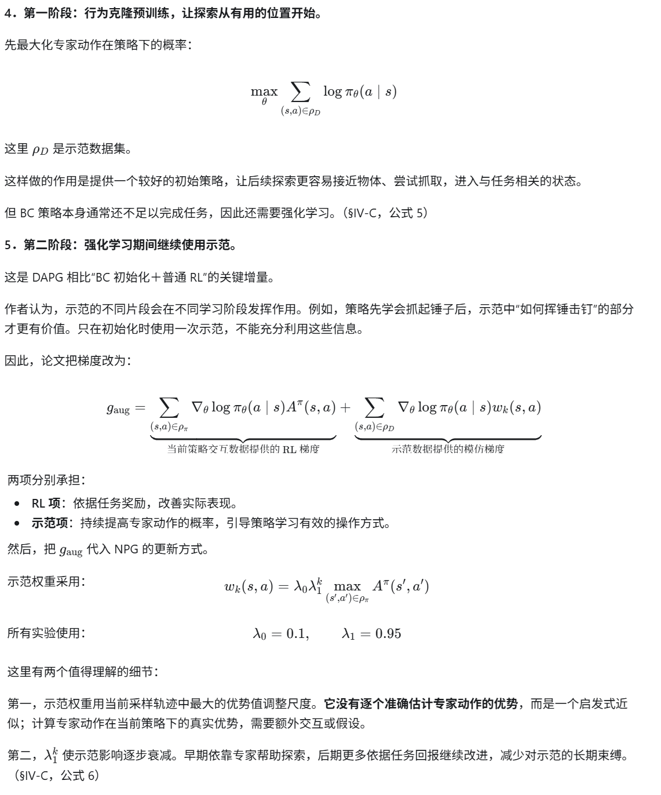
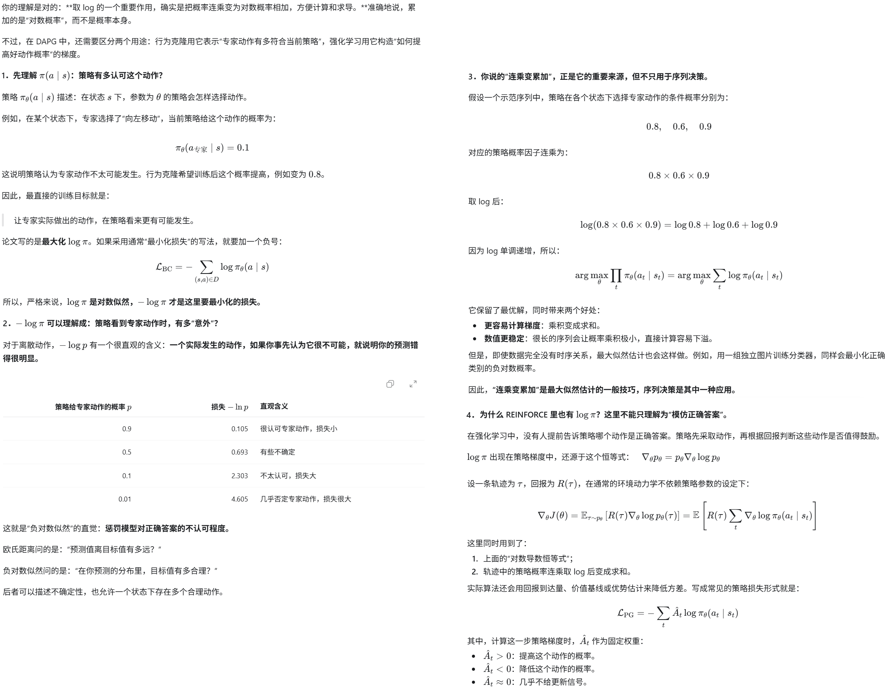

**Learning Complex Dexterous Manipulation with Deep Reinforcement Learning and Demonstrations**

RSS'2018, from UC伯克利、openAI

### 论文内容

一句话描述：

DAPG 是一种以自然策略梯度（NPG）为基础，先用少量专家示范进行行为克隆预训练，再在强化学习中加入权重逐渐衰减的示范模仿项，从而提高探索效率与策略性能的算法。

#### 一、背景：为什么多指灵巧操作值得研究，又特别难？

论文研究的是：能否让强化学习控制一只复杂的仿人手，完成搬动物体、手内调整物体、开门和使用工具等操作？

多指手的价值在于通用性：同一只手可以处理不同物体和任务。但你在第 1 页标黄的内容指出了它的三个核心困难：

- **观察和动作空间维度高**：需要协调许多关节，同时考虑物体与目标的状态。
- **接触关系复杂且不连续**：手指会不断接触、离开、滑动物体，动力学难以平滑描述。
- **存在欠驱动现象**：物体没有自己的执行器，需要通过接触间接控制其运动。

这使依赖精确动力学模型的轨迹优化方法很难应用。无模型强化学习可以通过交互学习，避免显式建立精确的接触动力学模型，因此很有吸引力。

论文用 **MuJoCo 中的 24 自由度 ADROIT 仿人手**建立了四类任务：

| 任务                | 要完成什么                         | 主要挑战                                       |
| ------------------- | ---------------------------------- | ---------------------------------------------- |
| 物体搬运 Relocation | 抓起球并移动到目标位置             | 连续完成接近、抓取、搬运，随机探索很难碰到成功 |
| 手内操作 Pen        | 在手内调整笔的朝向，与目标朝向一致 | 关节约束多，接触频繁切换                       |
| 开门 Door           | 先解除门闩，再将门打开             | 有先后顺序和隐含子目标                         |
| 工具使用 Hammer     | 抓起锤子，将钉子敲入木板           | 抓得住还不够，还要以合适姿态和力度使用工具     |

#### 二、问题：从零强化学习和单纯模仿，各自有什么不足？

**1．从零强化学习：探索难、交互量大、行为质量不理想。**

论文发现，只给“任务完成才有奖励”的稀疏奖励时，随机探索通常无法产生成功轨迹。没有成功经验，也就很难获得有效的学习信号。笔的手内操作是部分例外。

作者通过人工设计奖励塑形，把“如何完成任务”的知识写进奖励函数后，NPG 才能学会这些任务。但仍存在三个问题：

- 奖励需要仔细、费力地设计。
- 某些任务需要约 100 个机器人小时的交互量，真机训练成本很高。
- 学到的动作可能怪异、抖动，对物体质量和尺寸的变化也不够鲁棒。

例如，奖励函数可能鼓励机器人“最终打开门”，却很难充分表达“用自然的抓握和手腕姿态打开门”。

**2．单纯行为克隆：会模仿训练数据，却不一定能独立完成任务。**

行为克隆（Behavior Cloning，BC）把专家的状态—动作对作为监督数据，学习“在这个状态下，专家会做什么”。

问题是：执行时一个小错误，就可能让策略进入示范没有覆盖过的状态；接下来的动作更不可靠，误差逐步累积。这就是论文讨论的**分布偏移**。

论文给了一个很具体的例子：少量示范训练出的 BC 策略可能会拿起锤子，却很少能正确挥锤、击中钉子。

因此，作者要解决的问题是：

> 如何用少量示范引导探索、传递自然且鲁棒的操作方式，同时保留强化学习依据任务奖励继续改进的能力？

#### 三、解决方法：以 NPG 为基础，在两个阶段使用示范

**1．先理解 NPG：它怎样从 REINFORCE 改进而来？**

可以这样理解两者的区别：

> REINFORCE 根据回报估计“往哪里改”；NPG 进一步考虑“这样改，会使策略的动作概率分布变化多大”。

所以，你可以把 NPG 理解为**使用自然梯度进行更新的策略梯度算法**。它沿用了 REINFORCE 形式的梯度估计，但更新规则不同。（§IV-B，公式 2—4）

**2．明确算法关系：DAPG、NPG、DDPG、DDPGfD 怎么区分？**

| 比较项         | NPG                              | DAPG：本文方法                        | DDPG                                          | DDPGfD：对照方法                                |
| -------------- | -------------------------------- | ------------------------------------- | --------------------------------------------- | ----------------------------------------------- |
| 基础           | 自然策略梯度                     | **在 NPG 上加入示范**                 | 深度确定性策略梯度                            | 在 DDPG 上加入示范                              |
| RL 学习方式    | On-policy                        | RL 主体为 on-policy，另加专家监督项   | Off-policy                                    | Off-policy                                      |
| 策略形式       | 随机策略                         | 随机策略                              | 确定性 actor，探索时添加噪声                  | 延续 DDPG                                       |
| 策略更新依据   | 优势加权梯度，经 \(F^{-1}\) 修正 | RL 梯度＋示范梯度，经自然梯度方式更新 | 利用 critic \(Q(s,a)\) 对动作的梯度更新 actor | 延续 DDPG 的 actor–critic 更新                  |
| 如何使用示范   | 原始方法不使用                   | BC 预训练＋训练期间持续利用示范       | 原始方法不使用                                | 示范加入经验回放，并配合优先回放、n-step 回报等 |
| 在本文中的角色 | **基础算法及从零训练基线**       | 提出的方法                            | 从零训练对照                                  | 带示范的主要对照                                |

DAPG 的机制不同：它把专家动作的对数似然梯度直接加入策略更新。虽然使用了固定的示范数据，其 RL 主体仍然采用当前策略采集的轨迹，并没有因此变成 DDPG 式的 off-policy actor–critic。

论文选择这条路线的理由是：当时的经验表明，off-policy 方法成功时往往更省样本，但训练可能更不稳定；on-policy 方法在高维任务上较稳定，却通常需要更多交互。作者希望通过示范缓解后者的样本成本。这是论文的研究动机，不代表所有场景都有同样的优劣排序。

##### 和TD3+BC的思想很像

是的，你抓住了共同结构：**两者都把“提高任务回报”和“模仿数据中的动作”结合起来。**但它们用 BC 解决的问题不同：

| 对比          | DAPG                         | TD3+BC                                        |
| ------------- | ---------------------------- | --------------------------------------------- |
| 基础算法      | NPG                          | TD3                                           |
| 学习方式      | 在线强化学习，持续与环境交互 | 离线强化学习，使用固定数据集                  |
| 模仿对象      | 少量专家示范                 | 离线数据中的动作，未必都是专家动作            |
| BC 的主要作用 | 引导探索，帮助学会复杂行为   | 约束策略偏离数据，缓解对分布外动作的 Q 值误判 |
| 模仿项        | 专家动作的负对数似然         | 策略动作与数据动作的平方距离                  |
| 权重处理      | 示范权重随迭代衰减           | 根据 Q 值尺度调整回报项与 BC 项的相对权重     |
| 预训练        | 先进行 BC 预训练             | 原始方法不要求单独 BC 预训练                  |

而且，结合我们刚才的讨论：**若 DAPG 使用固定方差的高斯策略，其 BC 负对数似然就等价于缩放后的平方距离，连模仿项的数学形式都很接近。**

最关键的区别是：**DAPG 用示范帮助在线策略“探索到好行为”；TD3+BC 用数据约束离线策略“避免利用不可靠的 Q 值”。**

**3．示范从哪里来？**

采集系统包括：

- MuJoCo HAPTIX：连接人类操作与仿真环境。
- CyberGlove III：记录手指运动。
- HTC Vive tracker：跟踪手部基座。
- HTC Vive headset：提供立体视觉。

每个任务使用 **25 条成功示范轨迹**，包含完成任务的状态—动作序列。采集过程中，每个时间步向执行器加入少量均匀噪声，范围为 \([-0.1,0.1]\) 弧度，帮助数据覆盖偏离理想轨迹的情况，缓解分布偏移。

有一个重要例外：**笔的手内操作示范来自RL专家模型，而非 VR 人类操作。**由于 VR 缺乏触觉反馈，这个任务难以人工示范；作者先用精心设计的奖励训练一个 RL 专家，再用它生成示范。

#### 四、效果：交互更少、动作更自然、对环境变化更鲁棒

**1．样本效率：达到 90% 成功率所需交互量显著下降。**

下面是表 I 的结果。比较对象是 DAPG 与从零训练的 NPG：

| 任务     | DAPG：稀疏奖励 | NPG：塑形奖励 | NPG：稀疏奖励 | 相对塑形 NPG 的效率提升 |
| -------- | -------------- | ------------- | ------------- | ----------------------- |
| 物体搬运 | 5.77 小时      | 98 小时       | 未达到        | 约 17.0 倍              |
| 锤钉     | 6.10 小时      | 50 小时       | 未达到        | 约 8.2 倍               |
| 开门     | 4.67 小时      | 16.2 小时     | 未达到        | 约 3.5 倍               |
| 手内调笔 | 3.33 小时      | 96 小时       | 322 小时      | 约 28.8 倍              |

这里的“小时”是**机器人交互时长的折算值**。论文设定每次 RL 迭代采集 200 条、每条 2 秒的轨迹，因此每次迭代对应 400 秒交互。它不是完整实验的实际耗时，也不能视为真机训练记录。

这篇论文最值得抓住的贡献是：**少量示范不仅能初始化策略，还能在 NPG 学习过程中持续引导更新，使高维灵巧操作在稀疏奖励下更容易学成，并改善动作形态与对环境变化的适应性。**

#### 五、代码

[这里](https://github.com/aravindr93/hand_dapg)，初步看是基于pytorch的。

### 基础知识：log pi形态的目标函数如何理解

