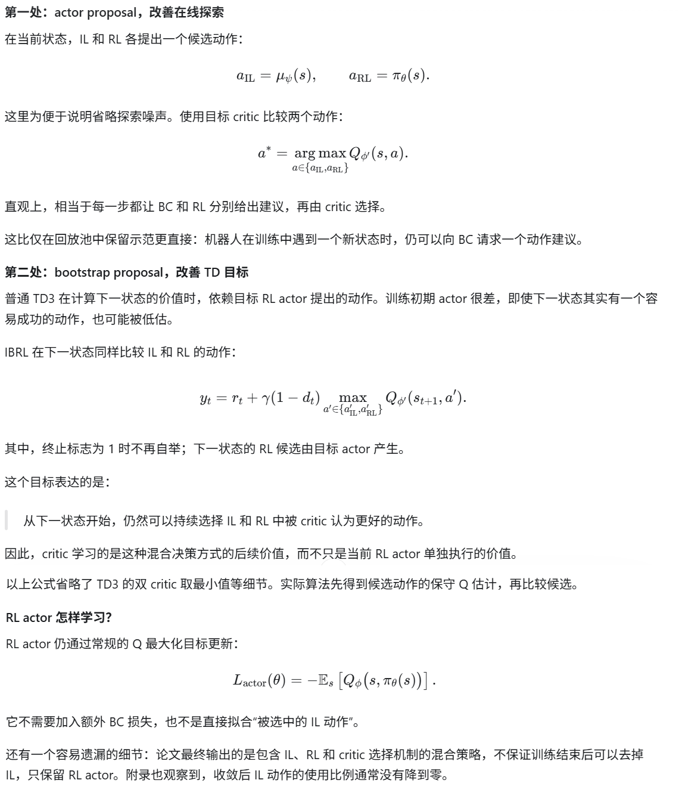
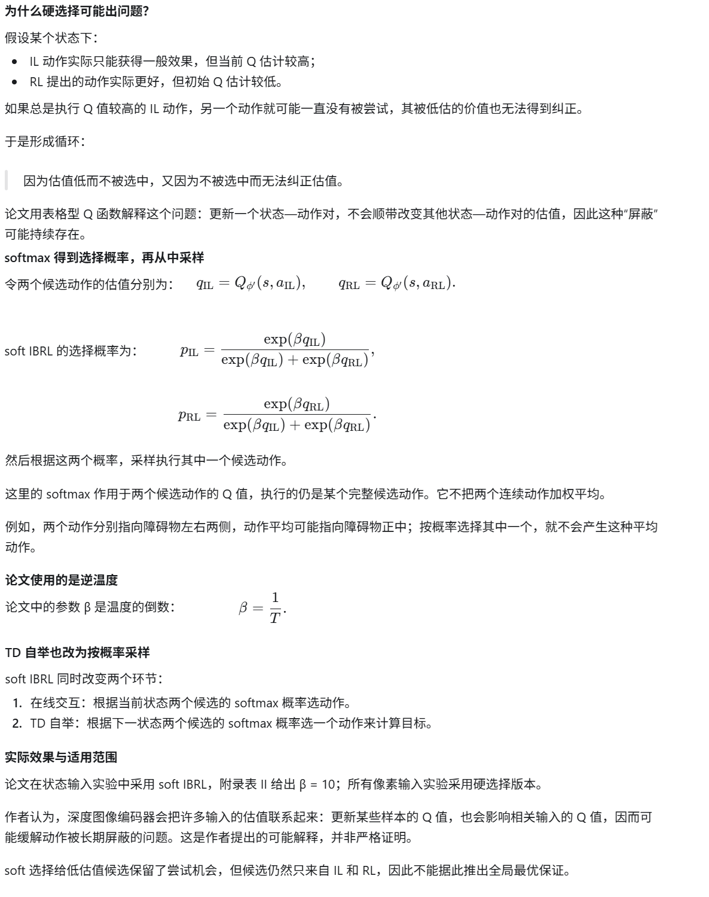
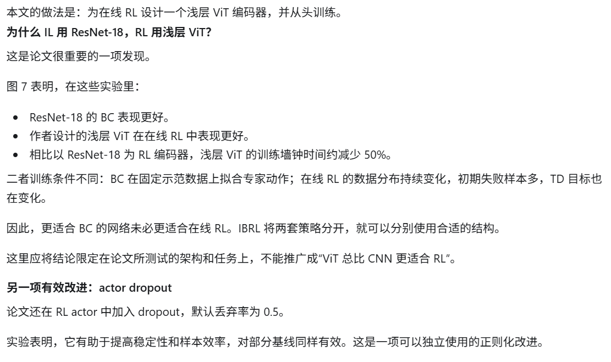
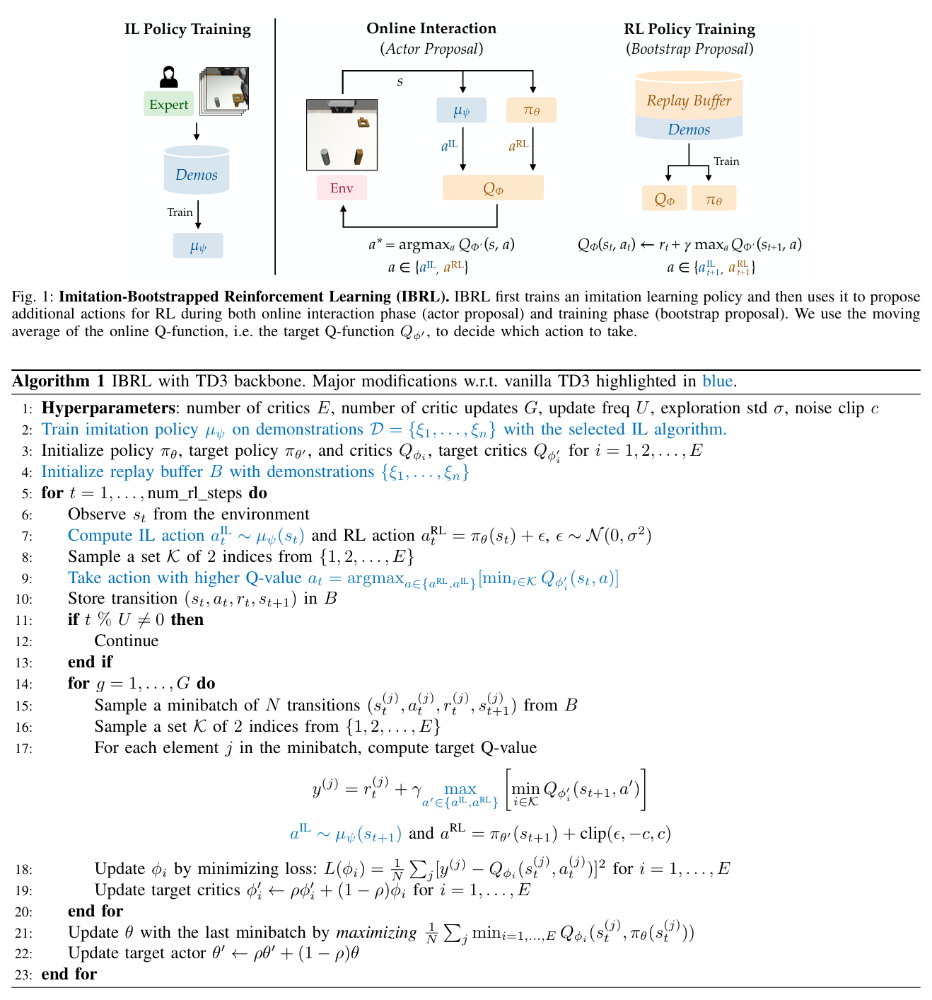
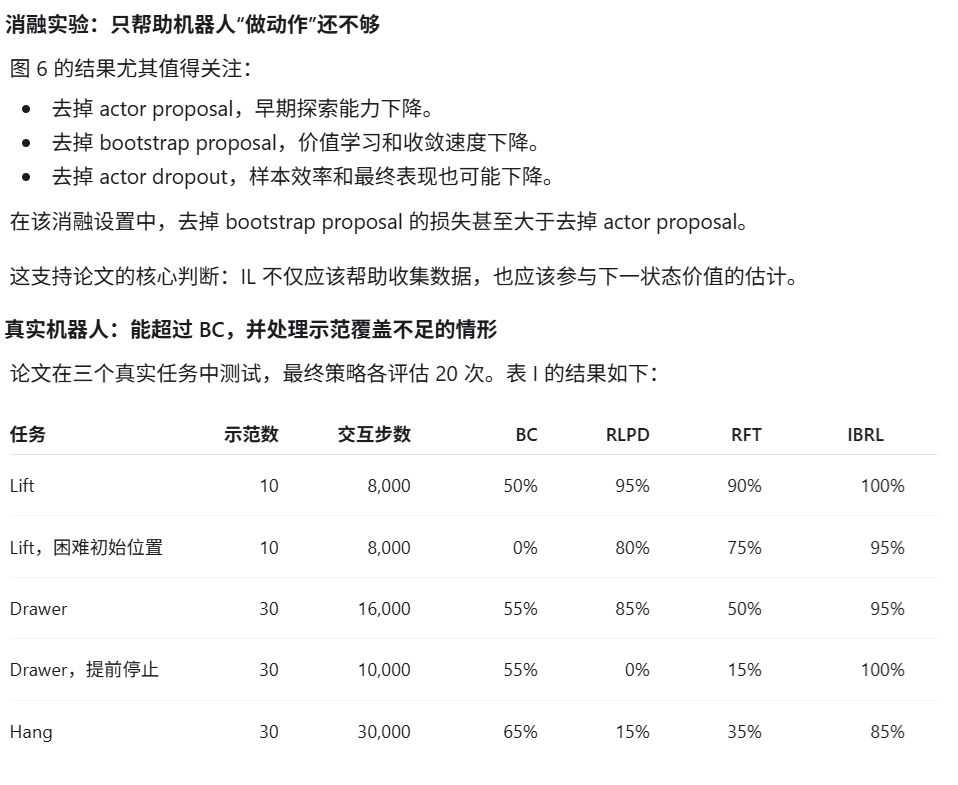

**Imitation Bootstrapped Reinforcement Learning**

RSS (Robotics: Science and Systems) 2024, from 斯坦福大学[ILIAD 实验室](https://iliad.stanford.edu/people/)

一句话描述：IBRL 先用离线示范数据训练并固定一个独立的模仿策略，再在在线 RL 训练中，让模仿策略与 RL 策略分别提出候选动作，由 critic 选择 Q 值较高者用于环境交互和 TD 目标计算，从而借助模仿策略加速探索与价值学习，并通过在线交互实现超越示范的策略改进。

### Introduction

#### 1. 背景：让模仿学习提供起点，让强化学习继续改进

论文《Imitation Bootstrapped Reinforcement Learning》的核心目标是：利用少量专家示范，让机器人以较低的交互成本开始强化学习，并最终超过原有模仿策略的表现。

机器人学习中，IL 和 RL 的优势恰好互补：

| 方法        | 优势                             | 主要困难                                 |
| ----------- | -------------------------------- | ---------------------------------------- |
| 模仿学习 IL | 利用示范快速学到有用行为         | 示范覆盖不足时容易失败，缺少自主改进机制 |
| 强化学习 RL | 可以通过交互纠错，发现更好的行为 | 稀疏奖励下探索困难，真实机器人交互昂贵   |

本文使用的奖励很简单：任务成功得到 1，否则得到 0。因此，最重要的难题是：RL 初始策略很差，可能长期无法完成一次任务，得不到有效学习信号。

另一方面，少量示范训练出的 BC 策略即使不能稳定完成任务，也通常能提出比随机策略更合理的动作。IBRL 就是要持续利用这种能力。

#### 2. 问题：怎样利用示范，又不让示范限制后续学习？

##### 2.1 已有方法的两种主要思路

第一种是把示范放进经验回放池，并提高示范的采样比例，例如 RLPD。

这使 RL 能反复学习成功轨迹，但它主要利用的是已经记录下来的状态和动作。一个训练好的 IL 策略，还能在新遇到的状态下提出合理动作，这部分能力没有被直接利用。

第二种是先通过 BC 预训练策略，再用 RL 微调，同时加入 BC 正则项，例如论文中的 RFT。

这种方法面对两个矛盾：

1. 训练初期，critic 不准确，RL 更新可能破坏已经学到的模仿行为。
2. 训练后期，过强的 BC 约束又可能阻碍策略超过示范。

因此需要调节 BC 正则的权重及其变化过程。此外，同一个策略网络需要同时适合 BC 和 RL，而两者未必偏好同样的网络结构。

##### 2.2 IBRL 的切入点

IBRL 将 IL 策略保留为一个独立、固定的动作提议者，再单独训练 RL 策略。

这样，IL 的知识不会被 RL 梯度改写；是否采用 IL 动作，由当前学到的 Q 值判断。RL 可以借助 IL，也可以在学得更好后逐步更多地使用自己的动作。

不过，这个选择依赖估计的 Q 值，不代表算法每次都能选中真实最优动作。

#### 3. 解决方法：把 IL 接入动作执行和价值自举两个环节

##### 3.1 核心算法：两处都比较 IL 和 RL

先用示范训练一个 BC 策略，再将它固定下来。同时初始化独立的 RL actor 和 critic，并把示范放入经验回放池。IBRL 本身不对示范进行额外过采样。

论文采用 TD3 作为 RL 主干，关键改动只有两个：

##### 3.2 IBRL的变种：soft IBRL

##### 3.3 其他改进

### Method

### experiments

### 代码

[这里](https://github.com/hengyuan-hu/ibrl)，代码似乎是基于robomimic的。