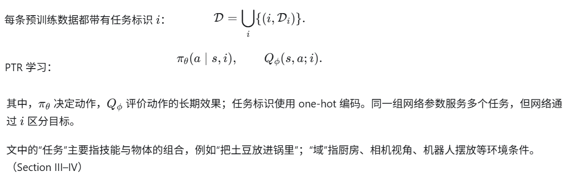
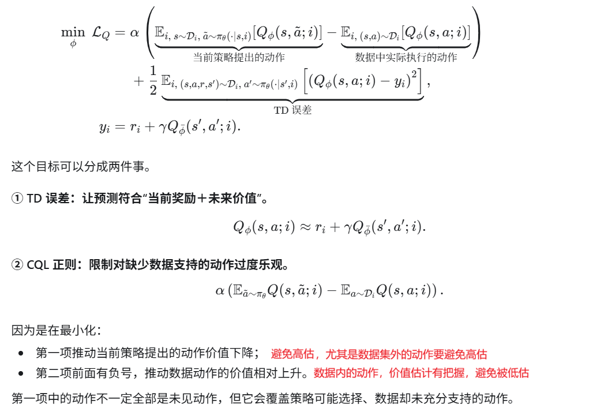
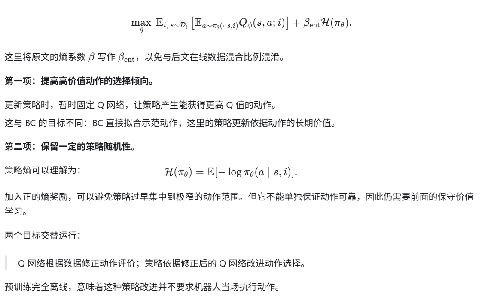
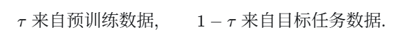
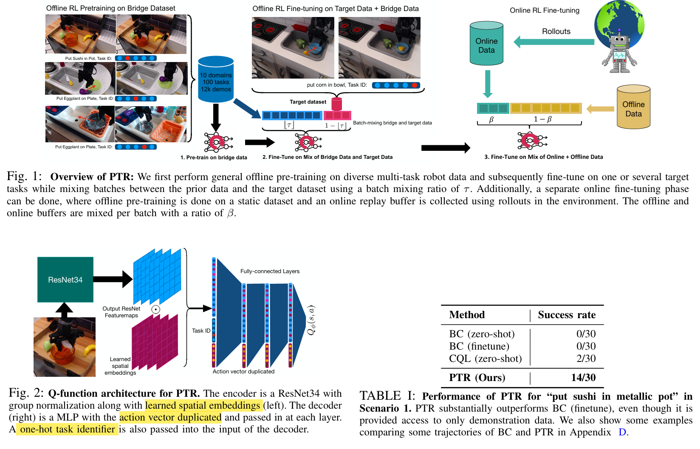

**Pre-Training for Robots: Offline RL Enables Learning New Tasks in a Handful of Trials**

RSS 2022（Robotics: Science and Systems）, from uc伯克利、斯坦福、纽约大学，作者之一是大牛Sergey Levine

一句话描述：PTR解决在兼容的观测与动作接口、统一的奖励尺度下，机器人在多任务间的迁移。先通过大量多任务离线强化学习，从已有示范中学习可迁移的策略和价值判断（离线预训练），再用少量目标任务示范适应新任务（微调阶段可以是offline RL或者online RL）；但让这条路线有效，网络结构、奖励标注和微调方式都很关键。

### 

#### 一、背景：机器人为什么需要“预训练—微调”？

机器人学习首先面对的是数据成本。

在视觉、语言领域，可以通过大量已有数据获得通用能力，再用少量数据适应下游任务。机器人也希望这样做，但为每个新任务重新采集大量真实交互或示范，成本很高。因此，单任务训练往往数据少、场景窄，遇到新物体、新厨房或新视角，性能就明显下降。

与此同时，已经存在 Bridge Dataset 这样的机器人数据集，包含多个厨房环境中的大量操作示范。问题在于：**这些数据很丰富，却未必直接包含你现在要完成的新任务。**

一种自然方案是先做行为克隆（BC），或先学习视觉表征，再用新任务示范微调。但作者认为，仅仅学会“看懂图像”或“模仿动作”，不一定能充分学会判断：

> 当前这个动作，会怎样影响任务最终能否成功？

因此，论文研究用离线强化学习贯穿预训练和微调，既学习策略，也学习动作后果对应的长期价值。

这里的 PTR，指 **Pre-Training for Robots**。它的主要贡献，是证明 CQL 配合一组关键设计，可以成为真实机器人上有效的预训练方法，而不是提出一种全新的离线 RL 算法。

#### 二、问题：有了多任务示范，为什么不能直接训练？

论文要解决的困难，可以沿着训练过程理解。

**第一，多任务经验如何形成可迁移的能力？**

预训练数据包含不同物体、技能和环境。网络需要共享有用经验，同时知道当前究竟要做哪个任务。否则，相似画面下，“把物体放进锅里”和“从锅里拿出来”的动作可能互相冲突。

**第二，只有少量新任务示范，如何真正适应？**

目标任务通常只有约 10–15 条示范。如果从零开始训练，数据不足；如果直接把它们混入规模很大的预训练数据集，新任务数据又很容易被淹没。

**第三，为什么离线 RL 容易学错动作价值？**

离线训练只能使用固定数据，不能执行一个陌生动作后，现场检查它是否真的有效。若 Q 网络高估了数据中缺少的动作，策略便可能反复选择这些“看起来很好、实际上没有依据”的动作。

**第四，大网络为什么不一定有效？**

多样化数据需要高容量网络，但把标准 ResNet 直接用于 TD 学习，会遇到训练不稳定、空间信息丢失，以及 Q 网络忽视动作输入等问题。

**第五，示范没有奖励，微调又容易过拟合。**

Bridge 数据中的示范虽然成功，却没有逐步奖励标注。与此同时，目标示范很少，训练不足无法适应，训练过久又会损失泛化能力。因此，奖励怎样生成、训练何时停止，都属于方法的一部分。

#### 三、解决方法：用任务条件化 CQL 预训练，再保持数据混合进行微调

**1．整体框架：策略和 Q 函数一起迁移**

训练分为：

- **预训练：**在已有多任务数据上，通过离线 CQL 同时训练策略和 Q 网络。
- **离线微调：**从预训练参数继续训练，使用旧数据和少量目标任务示范。
- **可选在线微调：**让机器人收集新交互，再混合离线、在线数据继续改进。

这里迁移的不只是视觉编码器，而是完整的策略与价值学习能力。

**2．Phase 1 的第一个目标：训练一个“有依据、不过度乐观”的 Q 函数**

为了区分数据动作与策略采样动作，下面将论文公式稍作符号整理，并补全任务条件：

不过，**数据动作也不能因此无限涨价**：TD 误差仍然约束它应当对应实际奖励和后续价值。两部分合起来，才形成“依据数据学习长期价值，同时限制无依据高估”的机制。

\(alpha\) 控制保守程度，论文主要离线操作实验使用 \(alpha=10\)。它不是学习率；过小可能压不住高估，过大则可能使价值过于保守。

**3．Phase 1 的第二个目标：让策略选择价值更高的动作**

论文的策略目标是：

**4．少量数据怎样微调：继续训练，但控制采样比例**

离线微调沿用同一个多任务 CQL 算法，同时更新策略与 Q 网络。

每个 minibatch 中：

这样，目标示范即使只有十来条，也能频繁参与更新；旧数据则继续提供经验和约束，降低仅拟合少量新数据的风险。

例如按正文的 \(\tau=0.8\)，每批中旧数据占 80%，目标数据占 20%。这里的比例是人为控制的，不是按两个数据集的原始大小自然抽样。

新任务的 one-hot 标识有两种处理方式：

- **预留位置：**预训练时就为新任务预留编码，但直到微调才使用。
- **复用旧标识：**将已有任务标识用于相近任务的重定向，例如从“放进透明锅”改成“放进金属锅”。

one-hot 只是任务标签，没有语言语义；预留一个位置，也不会自动使网络知道新任务该怎么做，仍需目标数据学习。

**困惑：怎么对齐不同任务之间的观测空间、动作空间、奖励幅度？**

**答案：** PTR 的实验主要是同一型号 WidowX250 机器人上的跨任务、跨场景迁移，没有验证任意异构机器人之间的统一训练。PTR 验证的是同一机器人平台上、以厨房抓取放置和开门为主的迁移。观测模态、动作维数和控制语义显著不同的多机器人学习，仍需额外方法。**PTR 验证的是统一机器人平台和数据接口下，跨物体、任务与场景的迁移，没有验证不同结构机器人之间、控制方式差异很大的迁移。**

**5．让上述流程有效的关键实现**

- **高容量 ResNet。** 提供处理多任务、多环境数据所需的表达能力。
- **Group Normalization。** 替代 Batch Normalization，以改善 TD 学习的训练稳定性。
- **Learned Spatial Embeddings。** 对特征图进行可学习的空间加权汇聚，保留物体和目标位置的信息，避免全局平均池化丢掉精细定位线索。
- **在 Q 网络每个全连接层输入动作。** 示范中的观测和动作高度相关，Q 网络可能主要依靠图像就拟合数据，从而忽视动作。反复输入动作，可以强化它对“同一观测下不同动作”的区分能力。
- 在线阶段混合历史离线数据和新收集数据，并对每个环境转移进行约 10 次梯度更新，以提高交互数据利用率。
- 对每条**已知成功的示范轨迹**，直接按位置标奖励：**最后 3 个时间步设为 1，其余设为 0。**原因是：任务实际完成后，人可能过一会儿才停止录制。 如果只给最后一步奖励，就会把前面已经成功的状态标成 0。给末三步奖励，相当于为停止录制的延迟留出余量。

#### 四、效果：少量目标示范下优于多种基线，但能力边界仍然明确

**主要结果：在新物体、新环境和新任务上取得提升**

| 场景与目标任务       | PTR   | BC 预训练后微调 |
| -------------------- | ----- | --------------- |
| 将寿司放入新金属锅   | 14/30 | 0/30            |
| 打开未见过的门       | 12/20 | 10/20           |
| 从金属碗中取出牛角包 | 7/10  | 3/10            |
| 将红薯放到盘子上     | 7/20  | 1/20            |
| 将刀放进锅中         | 4/10  | 2/10            |
| 将黄瓜放进锅中       | 5/10  | 0/10            |

部分任务成功率仍只有 35%—70%，多数真实任务仅评估 10—30 次。它证明了相对收益，还不足以说明已经达到可靠部署水平。

#### 五、代码

[这里](https://github.com/Asap7772/PTR)，基于jax，从头像看第一作者应该是个阿三，黑不溜秋脏兮兮的。