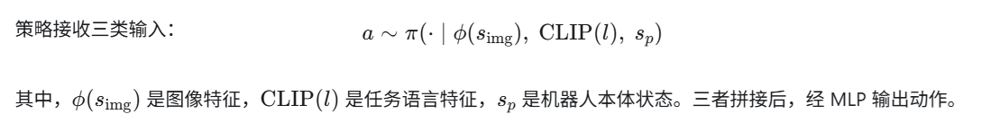
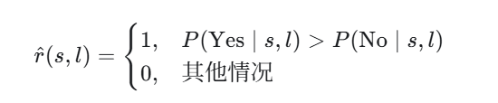
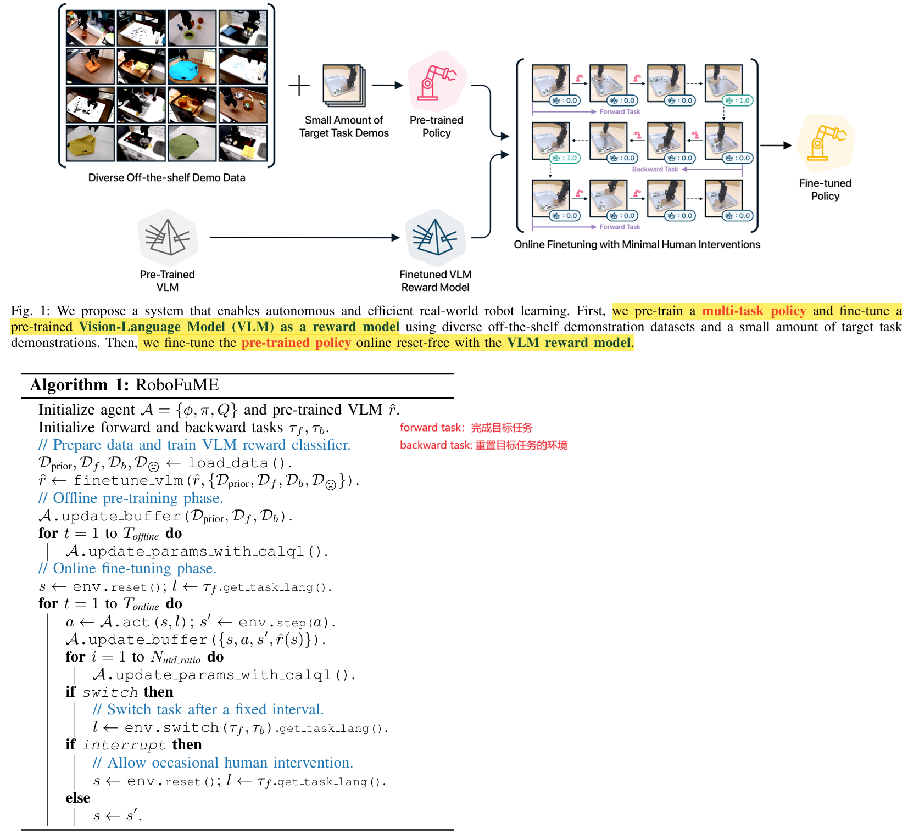

**Robot Fine-Tuning Made Easy: Pre-Training Rewards and Policies for Autonomous Real-World Reinforcement Learning**

 ICRA 2024, from 斯坦福大学和丰田研究所

一句话描述：**利用已有机器人示范数据预训练控制策略，同时将预训练视觉语言模型微调成奖励模型，再让机器人交替执行目标任务和重置任务，在少量人工干预下自主练习、持续改进。**

#### 一、背景：机器人学习也希望实现“预训练—微调”

在语言和视觉领域，模型可以先利用大规模已有数据学习通用知识，再用少量任务数据适应新任务。机器人学习也希望采用这一范式，因为真实机器人采集数据的成本很高。

一个自然的方案是：先用已有机器人数据进行离线强化学习，再部署到本地机器人上，通过在线交互适应新任务。

但真实机器人学习还有两项持续的人力成本：

- **判断是否成功。** 强化学习需要奖励，通常要人为设计成功判据或标注。
- **为下一轮尝试恢复环境。** 例如机器人把锅盖盖上后，还需要把锅盖移开，才能继续练习。已有研究的做法通常是训练一个策略负责重置环境。

已有研究分别探索了离线到在线强化学习、学习奖励函数、免人工重置训练，但论文认为，当时仍缺少一个能同时利用**多样化外部数据、自动奖励、自动重置**的有效系统。

#### 二、问题：如何把外部数据转化为低人工成本的真实机器人学习？

**1．外部数据与本地机器人之间存在分布偏移**

已有数据中的物体、场景布局、相机视角、光照等，可能与本地环境不同。因此，在外部数据上表现不错的策略，未必能在本地直接工作，也未必能通过少量在线交互顺利改进。

论文尤其强调：**以往不少工作在预训练和微调时使用同一台机器人、同一套硬件环境**，而 RoboFuME 希望利用**其他机构采集的现成数据**，适应本地的新任务。**这并不等于已经解决任意机器人形态之间的迁移。**

**2．策略预训练并没有消除在线训练的人力需求**

即使策略已有一定能力，如果每次练习都需要人来**判定成功、重置物体**，在线学习仍然昂贵。系统需要同时回答：

“机器人怎样自行判断任务完成？”以及“完成或失败后，怎样继续下一轮练习？”

**3．学出来的奖励可能被策略利用**

奖励分类器可能把未完成任务的状态误判为成功，即产生假阳性。强化学习会主动寻找高奖励行为，因此可能学会反复制造这种误判，而没有真正完成任务。

预训练 VLM 的零样本判断也不够准确；从少量本地数据训练的普通分类器，则可能对光照、视角和新状态敏感。因此，需要兼顾奖励模型的鲁棒性与策略训练的稳定性。

#### 三、解决方法：离线准备策略与奖励，在线交替执行任务与重置

RoboFuME 包含两个阶段：

**阶段一：离线预训练。** 从现有数据中训练语言条件多任务控制策略，并将预训练 VLM 微调为任务成功分类器。

**阶段二：在线自主微调。** 固定奖励模型，机器人交替执行目标任务与重置任务，利用新交互继续更新控制策略。

**1．两个阶段分别有哪些数据？**

论文将离线数据划分为四类。为方便阅读，下表将失败数据集记为 \(D_fail)。

| 数据                 | 包含什么                                             | 用于训练控制策略                   | 用于微调 VLM 奖励模型 |
| -------------------- | ---------------------------------------------------- | ---------------------------------- | --------------------- |
| 先验示范 (D_prior)   | 外部数据集中的多任务示范，包含状态、动作、下一状态等 | 是                                 | 是                    |
| 目标任务示范 \(D_f\) | 本地目标任务的成功示范                               | 是                                 | 是                    |
| 重置任务示范 \(D_b\) | 将环境从目标任务结束状态恢复到适合再次尝试状态的示范 | 是                                 | 是                    |
| 失败观测 \(D_fail)   | 目标任务与重置任务没有成功的图像                     | 否，论文未将其作为策略训练轨迹使用 | 是，作为额外负样本    |

每个任务还带有对应的语言描述。

真实机器人实验中，每个目标任务使用：

- 从 **BridgeData V2** 中选取的约 **1,000条相关先验示范轨迹**；
- **50条目标任务示范、50条重置任务示范**；
- 合计**少于20条失败轨迹**中的失败观测。

因此，论文中的“少量目标数据”具体包含正向、重置和失败数据，并非只需几条正向演示。

在线阶段新增的数据来自机器人自己的正向和重置交互：观测、动作、下一观测，以及 VLM 预测的奖励。新经验加入回放缓冲区，用于继续训练；已有离线数据也保留在系统中。论文没有明确给出各类数据的在线采样比例。

**2．两个阶段分别训练哪些模型？**

| 模型或组件             | 阶段一：离线准备                               | 阶段二：在线微调                         |
| ---------------------- | ---------------------------------------------- | ---------------------------------------- |
| 图像编码器             | 训练一个4层 CNN，通过 Critic 损失优化          | 作为控制智能体的一部分继续更新           |
| Actor／策略            | 用 CalQL 与 BC 正则训练语言条件多任务策略      | 利用在线经验继续训练，学习目标和重置行为 |
| Critic／价值函数 \(Q\) | 用 CalQL 训练，评估动作的长期收益              | 利用新增经验继续更新                     |
| MiniGPT-4 奖励模型     | 从已有预训练模型出发，用示范与失败观测微调     | **冻结，只负责预测奖励**                 |
| CLIP 文本编码          | 使用预训练文本嵌入表示任务，论文未描述对其微调 | 继续提供任务表示                         |
| GPT-4                  | 将任务名称改写为判断任务是否完成的问题         | 不作为在线控制策略或待训练模型           |

这里有两个关键区分：

**正向行为和重置行为由同一个语言条件策略实现**，通过不同指令切换，并不是分别训练两套独立控制策略。

**控制策略与 VLM 奖励模型是两个模型。** 策略输出机器人动作；VLM 判断当前状态是否成功。（第3—4页、算法1）

**3．策略怎样利用多任务数据？**

策略接收三类输入：

语言指令决定当前应该执行什么。例如，“盖上锅盖”对应正向行为，“移开锅盖”对应重置行为。这样，多任务示范就可以共同训练一个模型。

训练采用 **CalQL（校准 Q 学习）**。它建立在保守 Q 学习 CQL 的基础上，通过校准 Q 值尺度，使离线学到的价值函数更适合后续在线改进。论文给出的关键解释是：避免学到的策略 Q 值被压低到离线数据的蒙特卡洛回报以下。

此外，策略学习加入 **行为克隆 BC 正则**，鼓励动作接近示范。其作用有两层：

- 改善离线预训练效果；
- 限制在线行为过度偏离示范，降低利用奖励模型假阳性的机会。

BC 权重在离线和在线阶段保持一致。论文观察到，移除这项约束后，行为会在在线训练过程中退化。（第3—4页）

**4．VLM 怎样变成奖励模型？**

奖励模型使用 **MiniGPT-4**，输入是当前图像与关于任务完成情况的问题。

例如，任务指令为“把绿色卷心菜放进水槽”，先用 GPT-4 改写为“绿色卷心菜是否已经放进水槽？”，再将问题和当前图像输入 MiniGPT-4。

如果模型对 `Yes` 的预测概率高于 `No`，就输出成功奖励，否则输出失败奖励：

这是**稀疏二元奖励**，并不直接衡量动作质量或距目标还有多远。

由于原始 VLM 的零样本表现不足，作者利用示范构造训练标签：

- 每条示范的**最后3个状态**标为 `Yes`；
- 示范中的其他状态标为 `No`；
- 额外采集的失败观测也标为 `No`。

这种方式减少了逐帧人工标注，但依赖“成功示范最后几个状态确实代表完成”的假设。VLM 的大规模预训练则为抵抗光照、视角、干扰物变化提供基础。

**5．在线阶段怎样自主练习？**

在线学习形成一个循环：

1. 输入目标指令 \(l_f\)，执行目标任务。
2. VLM 判断成功后，切换到重置指令 \(l_b\)。
3. 策略执行重置行为，为下一次目标任务创造条件。
4. 在交互过程中收集经验，并持续更新 Actor、Critic 和图像编码器。

除了成功触发切换，系统还设置 **150步的任务切换上限**，避免长期卡在某个状态。在线阶段不再训练奖励模型。

不过，论文中的“reset-free”仍允许偶尔人工恢复：真实实验中，布料任务每 **15—25个 episode** 人工重置一次，其他任务每 **30—35个 episode** 重置一次；厨房场景还可能因机械臂力矩超限而中断。

因此，更准确的理解是：**利用学到的重置行为，显著减少逐轮人工重置，实现近自主训练。**

#### 四、效果：在线学习有效，但自主性与奖励准确性仍有边界

**1．真实机器人：在线微调后，五个任务都得到提升**

实验使用 WidowX 250 机械臂和一个第三人称相机。以下任务以图2和表I为准。

| 任务         | 行为克隆 BC | RoboFuME 离线预训练后 | 在线微调30,000步后 |
| ------------ | ----------- | --------------------- | ------------------ |
| 用布覆盖物体 | 45%         | 60%                   | **80%**            |
| 折布         | 60%         | 70%                   | **85%**            |
| 扫糖果       | 31%         | 47%                   | **66%**            |
| 盖锅盖       | 60%         | 40%                   | **95%**            |
| 搬运锅       | 45%         | 35%                   | **55%**            |

在线交互耗时约 **2—4小时**。按论文汇总，在线微调相对离线表现平均提升约 **51%**，相对 BC 平均提升约 **58%**；这两个数是相对提升，并非百分点提升。

指标需要区分：扫糖果统计的是7颗糖果中最终进入托盘顶部三分之一区域的平均比例；其余任务统计 **20次测试的成功率**。

行为上的改进包括：抓取失败后更愿意重试；扫糖果时能够连续多次清扫，而不是一次清扫后继续推撞托盘边缘。

同时，锅盖和搬锅任务的离线结果低于 BC，说明**优势主要体现在有效的在线改进能力，并非离线策略始终更强**。

**2．加入干扰物后，策略更稳健**

扫糖果任务在测试时加入训练中未见过的背景物体：

| 方法                | 无干扰物 | 有干扰物 |
| ------------------- | -------- | -------- |
| BC                  | 31%      | 3%       |
| RoboFuME 离线策略   | 47%      | 31%      |
| RoboFuME 在线微调后 | 66%      | 45%      |

微调后的 RoboFuME 保留约 **68%** 的原有表现，BC 只保留约 **10%**。作者推测，BC 更容易依赖与任务无关的视觉特征；不过，这属于对现象的解释，实验没有直接证明其内部机制。（第5—6页、表III）

**3．消融实验：先验数据、语言条件、CalQL 和 VLM 都有作用**

在真实扫糖果任务的离线评估中，完整方法为 **47%**；去掉先验数据降到 **23%**；用 one-hot 任务编号替代语言条件后降到 **13%**。这支持了外部数据和语言任务表示的价值。（表IV）

在仿真的 Vase 任务中：

- **CalQL 对稳定改进很关键。** 换成 CQL、SAC 或 AWAC 等更新方式，表现较差。
- **微调后的 VLM 奖励优于替代方案。** 它优于 VICE 对抗奖励；VIP 和从头训练的 CNN 奖励分类器未能带来有效在线提升。

三项仿真任务的曲线按 **3个随机种子**平均，完整方法持续优于 BC、MEDAL++ 及加入该 VLM 奖励的 ARIEL。（第5—6页、图3—5）

**4．奖励模型足以支持学习，但远非可靠的通用成功检测器**

论文报告的在线奖励分类结果如下：

| 任务         | 假阳性率 FP | 假阴性率 FN | 准确率 | 精确率 |
| ------------ | ----------- | ----------- | ------ | ------ |
| 用布覆盖物体 | 6.3%        | 80.9%       | 89.4%  | 15.3%  |
| 折布         | 1.2%        | 59.8%       | 84.1%  | 92.0%  |
| 搬运锅       | 6.1%        | 81.3%       | 86.9%  | 24.3%  |

作者强调，强化学习尤其需要避免假阳性，因为策略会主动利用“没做成却有奖励”的状态；漏掉部分成功状态未必会阻止学习。

但表II也揭示了明显限制：**部分任务漏判严重，而且模型判为成功的状态也不一定可靠。** 覆盖物体和搬锅的精确率分别只有15.3%和24.3%，因此不能只凭较高准确率或较低假阳性率，就认为奖励模型已十分可靠。

综合实验，论文较有力地支持：在这些指定任务、示范数据和少量人工恢复条件下，**CalQL 控制学习、BC 约束、冻结的 VLM 奖励以及正反任务交替，可以共同支持有效的真实机器人在线改进**。其贡献主要是这套系统的组合与验证；奖励零样本泛化、重置效率和更彻底的无人干预，仍是后续问题。

#### 五、代码

未开放代码，鄙视